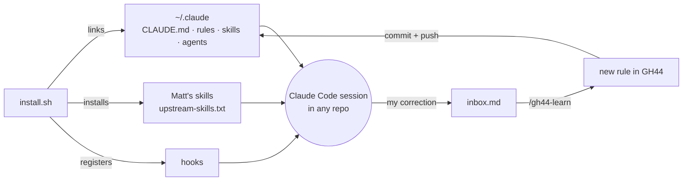
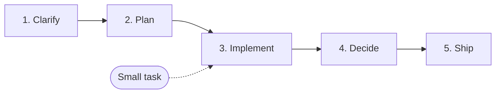

# GH44

**Gentrit's personal agent brain for Claude Code.**

Clone it once and every Claude Code session, in any repository, works the way I do: same rules, same workflow, same code conventions. Lint hooks check the code for free, and it learns from my corrections.

```bash
git clone git@github.com:gentrithalili1/gh44.git && gh44/install.sh
```

> The repository's own `CLAUDE.md` / `AGENTS.md` always wins on code conventions. GH44 fills the gaps.

<br><br>

---

<br><br>

## How it works



| Part | Lives in | Loaded |
| --- | --- | --- |
| 🧭 **Rules**: how I work and how I write code | `rules/` | Every session (under 160 lines) |
| 🧰 **Skills**: the workflow steps | `skills/` + [Matt's skills](#skills) | When used |
| 🤖 **Agents**: review and verify in a fresh context | `agents/` | When used |
| 🔍 **Lint + hooks**: my conventions as ESLint rules | `lint/`, `hooks/` | Free, no tokens |
| 🧠 **Learning**: corrections become rules | `/gh44-learn` | When learning |

Everything is linked, not copied: editing this repo changes every session at once.

<br><br>

---

<br><br>

## The workflow



```text
/gh44-clarify ABC-123   # optional: interview until nothing is open
/gh44-plan              # seams + slices → you approve
/gh44-implement         # builds, tests, verifies, reviews itself
                        # you decide the numbered judgement calls
/gh44-create-pr         # commit, push, open the PR
```

| Step | You run | What happens |
| --- | --- | --- |
| **1. Clarify** | `/gh44-clarify [ticket]` | Reads the ticket, then interviews you in rounds of numbered questions with a recommended answer each. Claude looks up the facts and asks you only for decisions. |
| **2. Plan** | `/gh44-plan [ticket]` | Test seams and tracer-bullet slices: what each delivers, the units it touches, acceptance criteria, what must land first. Ends when you approve. |
| **3. Implement** | `/gh44-implement [ticket] [--worktree]` | Each slice red → green (`tdd`), then typecheck and its tests. Then `gh44-verifier` and `gh44-reviewer`: clear fixes applied, judgement calls listed for you. Never commits. |
| **4. Decide** | Read implement's report | Pick the judgement calls to apply ("apply 1 and 3"). Optional: `/code-review` for a bug hunt. |
| **5. Ship** | `/gh44-create-pr` | Verifies, commits, pushes, opens the PR. The body has a summary visual, before/after evidence and merge danger. |

- **Small task** (a bug, one clear area): start at `/gh44-implement <ticket>`.
- **Clear ticket**: start at `/gh44-plan <ticket>`. It asks up to 4 questions itself and sends you to `/gh44-clarify` when there are more.
- **Clarify, plan and implement run in one session**, so each builds on the last. Clarify decides _what_, plan decides _how_.
- **Your rules apply without being asked**: they load in every session, the plan places files by `structure.md`, and lint and the verifier check the result.

<br><br>

---

<br><br>

## Skills

**Mine**, in workflow order. _You type_ = only runs when you call it. _Auto_ = Claude also loads it when the work matches.

| Skill | Starts | What it does |
| --- | --- | --- |
| `/gh44-clarify [ticket]` | You type | Reads the ticket, then runs Matt's `grilling` unchanged. |
| `/gh44-plan [ticket]` | You type | Seams and slices from the conversation or a ticket. |
| `/gh44-implement [ticket] [--worktree [name]]` | You type | Builds the plan or a small ticket, verifies, reviews itself, reports. |
| `/gh44-debug` | Auto | Diagnosis loop for hard bugs, slowdowns and Sentry issues. |
| `/gh44-code-review [pr]` | Auto | Reviews a PR, branch or local changes on **Standards** (repo rules → my rules → my habits → smells) and **Spec** (the ticket's criteria). Someone else's PR: posts what you pick. Yours: applies what you pick. |
| `/gh44-resolve-conflicts <pr>` | You type | Merges the base in, shows the resolutions, pushes after you approve. |
| `/gh44-create-pr` | Auto | Verifies, commits, pushes, opens the PR; Matt's `pr` writes the body. |
| `/gh44-handoff [next focus]` | You type | Runs Matt's `handoff`, then prints the commands to continue in a fresh session. |
| `/gh44-learn` · `ingest` · `tidy` · `retro` | Auto | Turns corrections into rules (see [Learning](#learning)). |

**Matt Pocock's**, installed unchanged from [`upstream-skills.txt`](upstream-skills.txt). Update with `npx skills update -g`.

| Skill | Used by |
| --- | --- |
| `grilling` | `/gh44-clarify` |
| `handoff` | `/gh44-handoff` |
| `tdd` | `/gh44-implement` for every slice, and Claude for any test-first work |
| `codebase-design` | `tdd`, when an interface's shape is unclear |
| `pr` | `/gh44-create-pr`, and Claude whenever it writes a PR body |
| `writing-for-agents` | Claude, when writing skills, rules or a `CLAUDE.md` |

**Agents**, each in its own context, returning only a result:

| Agent | Used by | Returns |
| --- | --- | --- |
| `gh44-verifier` | implement, create-pr, code-review | `PASS`, or the typecheck, lint and test failures of the changed packages |
| `gh44-reviewer` | implement, code-review | The review, read-only |

<br><br>

---

<br><br>

## Rules, lint and hooks

**Rules** ([`rules/`](rules/)) load in every session: [`communication`](rules/communication.md), [`workflow`](rules/workflow.md), [`code`](rules/code.md), [`structure`](rules/structure.md), [`precedence`](rules/precedence.md) and [`learning`](rules/learning.md).

**Lint** ([`lint/`](lint/)) turns my conventions into ESLint rules. Every TS edit is fixed quietly, so the red → green loop runs uninterrupted; what is left is reported at the end of the turn and Claude fixes it. **A rule the repo already configures turns mine off.**

| Area | Rules |
| --- | --- |
| Types | No `any`, no `as` assertions, no lint-disable comments |
| Naming | `is*`/`has*`/`should*` booleans, `handle*` handlers, `<Component>Props` |
| Functions & hooks | Params object for 2+ parameters, no hook destructuring, no `useEffect` |
| JSX | Function components, no nested ternaries, no index `key`, no leaky `&&` |
| Structure | Sorted imports, re-export-only `index` files, no generic folders, pure `utils/` |

**Hooks** ([`hooks/`](hooks/)), all shell:

| When | Hook | Does |
| --- | --- | --- |
| Session start | `budget-check.sh` | Warns when rules pass 160 lines or the inbox fills up |
| Every prompt | `capture-corrections.sh`, `mark-turn.sh` | Saves short corrections to the inbox; marks the turn start |
| After a TS edit | `check-code.sh` | Fixes what ESLint can, quietly |
| End of turn | `check-changed.sh` | Reports what is left in the TS files changed this turn |
| New worktree | `prepare-worktree.sh` | Branch from `main`, copies `.env*` files, installs deps. Used by `--worktree`, `/gh44-resolve-conflicts` and your editor |

### Worktrees

`/gh44-implement ABC-123 --worktree` builds in `.worktrees/ABC-123` on its own branch (`--worktree <name>` picks the name; an existing one is reused).

- **Terminal:** run it from the main checkout; the session moves into the worktree.
- **Editor:** a session cannot move windows, so create the worktree in the editor first, named after the ticket, and run the command in its window. Point the editor's worktree hook at `<gh44>/hooks/prepare-worktree.sh <worktree> <main checkout>` so it is ready before the agent starts.

A repo's git-excluded `.worktree-setup.sh` replaces the default setup.

<br><br>

---

<br><br>

## Learning

GH44 gets better every time I correct it.

1. **Capture.** A short prompt starting with _don't, never, always, stop, prefer_ or _not like this_ is saved to `inbox.md`.
2. **Learn.** Claude writes the rule to the right place here, commits and pushes. When unsure, it asks first.
3. **Ingest.** `/gh44-learn ingest` sorts what is left in the inbox, including notes and links I paste there.
4. **Tidy.** `/gh44-learn tidy` merges duplicates, drops stale rules and keeps the core under 160 lines.
5. **Retro.** `/gh44-learn retro` looks back over a session for friction I never corrected and proposes fixes. Gaps in a team repo come back as suggestions only.

Every change is recorded in [`log.md`](log.md).

<br><br>

---

<br><br>

## Install and uninstall

**Needs:** Homebrew, Node and pnpm. Then open a new Claude Code session.

```bash
gh44/install.sh                  # safe to run again
gh44/uninstall.sh                # remove links, hooks and Matt's skills, keep the repo
gh44/uninstall.sh --remove-repo  # also delete the repo
```

`install.sh` installs `jq` and the lint packages, links `CLAUDE.md`, `rules/`, skills and agents into `~/.claude`, installs the skills in `upstream-skills.txt`, and registers the 5 hooks. It stops before changing anything when a real file is in the way, and backs up `settings.json`.

`uninstall.sh` removes only what GH44 added. `--remove-repo` refuses when something would be lost: uncommitted changes, unpushed commits or inbox items.

```text
gh44/
├── CLAUDE.md            # linked to ~/.claude/CLAUDE.md
├── rules/  skills/  agents/  hooks/  lint/  tests/
├── upstream-skills.txt  # Matt's skills, installed unchanged
├── install.sh  uninstall.sh
├── log.md               # every rule learned
└── inbox.md             # captured corrections (gitignored)
```

<br><br>

---

<br><br>

## Credits

Some skills are adapted from, or call, [Matt Pocock's skills](https://github.com/mattpocock/skills) (MIT). See [`NOTICE`](NOTICE).
