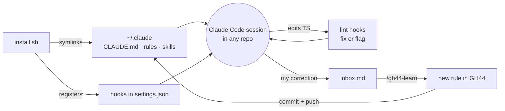
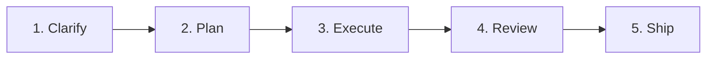

# GH44

**Gentrit's personal agent brain for Claude Code.**

Clone it once and every Claude Code session, in any repository, works the way I do: same rules, same workflow, same code conventions. It checks itself with lint hooks that cost no tokens, and it learns from my corrections as I go.

```bash
git clone git@github.com:gentrithalili1/gh44.git && gh44/install.sh
```

> The repository's own `CLAUDE.md` / `AGENTS.md` always wins on code conventions. GH44 fills the gaps.

---

## Contents

- [At a glance](#at-a-glance)
- [How it works](#how-it-works)
- [The workflow](#the-workflow)
- [Skills](#skills)
- [Agents](#agents)
- [Rules](#rules)
- [Lint checks](#lint-checks)
- [Hooks](#hooks)
- [Learning loop](#learning-loop)
- [Repository layout](#repository-layout)
- [Install](#install)
- [Uninstall](#uninstall)
- [Credits](#credits)

---

## At a glance

| Part | Lives in | What it does | Token cost |
| --- | --- | --- | --- |
| 🧭 **Rules** | `rules/` | How I work: communication, workflow, code, precedence, learning. Loaded in every session. | Always loaded, kept under 160 lines |
| 🧰 **Skills** | `skills/` | Step-by-step playbooks for clarifying, TDD, debugging, reviewing, shipping. Loaded only when the work needs them. | Only when used |
| 🤖 **Agents** | `agents/` | Subagents that review and verify in a fresh context, so the main session stays clean. | Only when used |
| 🔍 **Lint checks** | `lint/` | My conventions as ESLint rules, run on every TS edit. Fixes what it can, sends the rest back to Claude. | None |
| 🪝 **Hooks** | `hooks/` | Glue that runs lint, captures corrections, opens worktrees and guards the rules budget. | None |
| 🧠 **Learning** | `inbox.md`, `/gh44-learn` | Turns my corrections into new rules, committed back to this repo. | Only when learning |

---

## How it works



`install.sh` symlinks `CLAUDE.md`, `rules/` and every skill into `~/.claude`, so editing this repo changes every session at once. No copying, no re-installing after a `git pull`.

---

## The workflow

Every task goes through five steps. Small tasks skip straight to **Execute**; big ones use every step.



| Step | What you do | What runs |
| --- | --- | --- |
| **1. Clarify** | Type `/gh44-grill-me` and describe the feature or ticket. Answer each round until nothing is left open. | `/gh44-grill-me` |
| **2. Plan** | Ask for a plan, or switch to plan mode (`shift+tab`). Approve the step-by-step plan before any code is written. | `rules/workflow.md` |
| **3. Execute** | Let Claude build it slice by slice, tests first where it makes sense. | `gh44-tdd`, `gh44-debug`, lint hooks |
| **4. Review** | Run `/gh44-review-pr` on your branch, fix what matters, then `/code-review` for bugs and `/simplify` for cleanups. | `/gh44-review-pr`, `/code-review`, `/simplify` |
| **5. Ship** | Run `/gh44-create-pr`: it checks, commits, pushes and opens the PR with a summary visual, how to test and risk. | `/gh44-create-pr` |

### Shortcuts

- **Worktree per ticket:** `/gh44-ticket <link>` creates `.worktrees/<ticket ID>` on its own branch from the latest `main` (see [Worktrees and your editor](#worktrees-and-your-editor)).
- **Hand off a long session:** run `/gh44-handoff` and start a fresh session from the file it writes.
- **Merge conflicts:** run `/gh44-resolve-conflicts <pr>`.

---

## Skills

In workflow order. **Auto** skills load when the work matches, and you can also type them. **You type** skills run only when you call them.

| Step | Skill | How it starts | What it does |
| --- | --- | --- | --- |
| Start | `/gh44-ticket <Linear or Sentry link>` | Auto | Reads the ticket, creates a ready-to-run worktree named after the ticket ID, then plans (Linear) or debugs (Sentry). Read-only on Linear and Sentry. |
| Clarify | `/gh44-grill-me [ticket]` | You type | Reads the ticket if given, then runs Matt's `grilling`: rounds of questions, each with a recommended answer, until nothing is open. |
| Build | `/gh44-tdd` | Auto | Red-green-refactor loop, integration tests, mocking guidance. |
| Build | `/gh44-debug` | Auto | Diagnosis loop for hard bugs and slowdowns. |
| Review | `/gh44-review-pr [pr]` | Auto | Reviews a PR, branch or local changes the way I review. Posts only what you pick. |
| Review | `/gh44-resolve-conflicts <pr>` | You type | Merges the base in a worktree, shows the resolutions, pushes after you approve. |
| Ship | `/gh44-create-pr` | Auto | Checks, commits, pushes and opens the PR with the repo's template. |
| Session | `/gh44-handoff [next focus]` | You type | Runs Matt's `handoff` to write the session down, then prints the commands to continue in a fresh session. |
| Brain | `/gh44-learn` · `ingest` · `tidy` | Auto | Saves a correction as a rule, sorts the inbox, cleans up the rules. |
| Brain | `/gh44-writing-for-agents` | Auto | How to write skills, rules and `CLAUDE.md` files, this repo included. |

---

### Upstream skills

Skills I use exactly as their author wrote them are installed, not copied into `skills/`. [`upstream-skills.txt`](upstream-skills.txt) lists them, and a thin `gh44-*` proxy calls each one, so every command I type stays `/gh44-*`. Update them with `npx skills update -g`.

| Skill | From | Called by |
| --- | --- | --- |
| `grilling` | [mattpocock/skills](https://github.com/mattpocock/skills) | `/gh44-grill-me` |
| `handoff` | [mattpocock/skills](https://github.com/mattpocock/skills) | `/gh44-handoff` |

---

## Agents

Linked into `~/.claude/agents`. Each runs in its own context and returns only its result.

| Agent | Used by | Returns |
| --- | --- | --- |
| `gh44-reviewer` | `/gh44-review-pr`, before `/gh44-create-pr` | The review in my style. Read-only; posting stays in the main session. |
| `gh44-verifier` | "Verify before done", `/gh44-create-pr` | `PASS`, or the typecheck, lint and related-test failures for the changed packages. |

---

## Rules

Always loaded, in every repository. Kept short on purpose: the session-start hook warns when they pass 160 lines.

| File | Covers |
| --- | --- |
| [`communication.md`](rules/communication.md) | Casual, short answers. One best option: just do it. Several real options: ask once, recommend one. |
| [`workflow.md`](rules/workflow.md) | Clarify → plan → execute → review → ship. Smallest correct change. Verify before saying done. Merge from `main`. |
| [`code.md`](rules/code.md) | Types, errors, async, naming, React and JSX, SEO and rendering, data layer, forms, tests. |
| [`structure.md`](rules/structure.md) | Where files live: unit shape, placement by importers, state flow, file kinds, homes, splitting hooks, refactors. |
| [`precedence.md`](rules/precedence.md) | The repo wins on code conventions; my rules win on how to work with me. |
| [`learning.md`](rules/learning.md) | When Claude may write a rule on its own, and when it must ask first. |

---

## Lint checks

My conventions as ESLint rules ([`lint/`](lint/)), run by hooks on every TypeScript edit. Fixable problems are fixed silently; the rest go back to Claude to fix. Inline `eslint-disable` comments are ignored.

**If the repository already configures an equivalent rule, mine turns off**, so the repo always wins.

| Area | Rules |
| --- | --- |
| Types | No `any`, no `as` assertions, no lint-disable comments |
| Naming | Booleans `is*`/`has*`/`should*`, handlers `handle*`, props interface `<Component>Props` |
| Functions & hooks | Params object for 2+ parameters, no hook destructuring, no `useEffect` |
| JSX | Function components only, no nested ternaries, no index `key`, no leaky `&&` renders |
| Structure | Sorted imports, `index` files only re-export, no generic folders, pure `utils/` |

---

## Hooks

Registered in `~/.claude/settings.json` by `install.sh`. All shell, no tokens.

| When | Hook | Does |
| --- | --- | --- |
| Session start | `budget-check.sh` | Warns when core rules pass 160 lines or the inbox fills up. |
| Every prompt | `capture-corrections.sh` | Catches short corrections (see [Learning loop](#learning-loop)). |
| Every prompt | `mark-turn.sh` | Marks the start of a turn for the end-of-turn check. |
| After a TS edit | `check-code.sh` | Runs ESLint on the changed lines; fixes or reports. |
| End of turn | `check-changed.sh` | Re-checks every TS file changed in the turn, however it was edited. |
| New worktree | `prepare-worktree.sh` | Puts a detached worktree on a branch named after its folder, from the remote's default branch. Copies the main checkout's gitignored `.env*` files and installs from the lockfile. A repo's git-excluded `.worktree-setup.sh` replaces these steps. Run by `/gh44-ticket` and by your editor's worktree hook. |

### Worktrees and your editor

`/gh44-ticket` works in any setup:

- **Agent in a terminal:** run it from the main checkout. It creates `.worktrees/<ticket ID>`, prepares it and moves the session there.
- **Agent inside an editor window:** a running session cannot move to another window, so create the worktree in the editor first, named after the ticket ID, then run `/gh44-ticket <link>` in that worktree's window. It prepares the worktree and creates the branch if the editor's hook did not.

If the editor can run a command after it creates a worktree, point it at `<gh44>/hooks/prepare-worktree.sh <worktree> <main checkout>`, and set its worktree folder to `.worktrees`, so the worktree is ready before the agent starts.

---

## Learning loop

GH44 gets better every time I correct it.

1. **Capture.** A prompt of up to 100 characters starting with *don't, never, always, stop, prefer, I prefer* or *not like this* (optionally after `no,`) is flagged and saved to `inbox.md`.
2. **Learn.** Claude finishes the task, then writes the rule to the right file here, commits and pushes, and tells me in one line. If it's unsure, it shows me the rule first and waits.
3. **Ingest.** `/gh44-learn ingest` sorts anything still left in the inbox, including notes and links I paste there myself.
4. **Tidy.** `/gh44-learn tidy` merges duplicates, resolves contradictions, drops stale rules and moves topic-specific ones into skills when the core passes 160 lines.

---

## Repository layout

```text
gh44/
├── CLAUDE.md        # entry point, linked to ~/.claude/CLAUDE.md
├── rules/           # always-on rules
├── skills/          # gh44-* skills, each linked into ~/.claude/skills
├── agents/          # gh44-* subagents, each linked into ~/.claude/agents
├── hooks/           # shell hooks registered by install.sh
├── lint/            # ESLint config and custom rules
├── tests/           # shell tests for hooks, lint and install
├── docs/            # design spec and plan
├── install.sh       # idempotent installer
├── uninstall.sh     # removes links, hooks, upstream skills and optionally the repo
├── upstream-skills.txt  # skills installed as they are, called by gh44 proxies
├── log.md           # append-only log of every rule learned
└── inbox.md         # captured corrections (gitignored)
```

---

## Install

**Needs:** Homebrew, Node and pnpm.

```bash
git clone git@github.com:gentrithalili1/gh44.git && gh44/install.sh
```

Then open a new Claude Code session.

The installer is safe to run again. It:

1. Installs `jq` with Homebrew if it's missing.
2. Installs the lint packages with pnpm.
3. Symlinks `CLAUDE.md`, `rules/` and every skill into `~/.claude`. It stops before changing anything if a real file is in the way.
4. Installs the skills in `upstream-skills.txt` with the [`skills`](https://github.com/vercel-labs/skills) CLI, as copies in `~/.claude/skills`. A skill already there is left alone.
5. Registers the 7 hooks, backing up `settings.json` first.

---

## Uninstall

```bash
gh44/uninstall.sh                # remove links, hooks and upstream skills, keep the repo
gh44/uninstall.sh --remove-repo  # also delete the repo
```

It only removes links that point into this repo, hooks that run its scripts and upstream skills the skills lock file records as installed from their listed repository, and it backs up `settings.json` first. Your other skills, hooks and settings stay.

`--remove-repo` refuses, before changing anything, when something would be lost: uncommitted changes, unpushed commits, or items still in `inbox.md`.

---

## Credits

Some skills are adapted from [Matt Pocock's skills](https://github.com/mattpocock/skills) (MIT). See [`NOTICE`](NOTICE).
