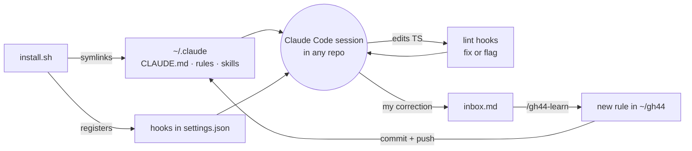
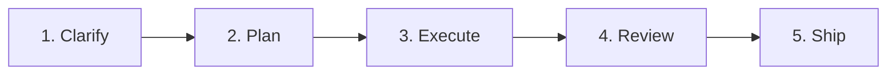

# GH44

**Gentrit's personal agent brain for Claude Code.**

Clone it once and every Claude Code session, in any repository, works the way I do: same rules, same workflow, same code conventions. It checks itself with lint hooks that cost no tokens, and it learns from my corrections as I go.

```bash
git clone git@github.com:gentrithalili1/gh44.git ~/gh44 && ~/gh44/install.sh
```

> The repository's own `CLAUDE.md` / `AGENTS.md` always wins on code conventions. GH44 fills the gaps.

---

## Contents

- [At a glance](#at-a-glance)
- [How it works](#how-it-works)
- [The workflow](#the-workflow)
- [Skills](#skills)
- [Rules](#rules)
- [Lint checks](#lint-checks)
- [Hooks](#hooks)
- [Learning loop](#learning-loop)
- [Repository layout](#repository-layout)
- [Install](#install)
- [Credits](#credits)

---

## At a glance

| Part | Lives in | What it does | Token cost |
| --- | --- | --- | --- |
| 🧭 **Rules** | `rules/` | How I work: communication, workflow, code, precedence, learning. Loaded in every session. | Always loaded, kept under 60 lines |
| 🧰 **Skills** | `skills/` | Step-by-step playbooks for clarifying, TDD, debugging, reviewing, shipping. Loaded only when the work needs them. | Only when used |
| 🔍 **Lint checks** | `lint/` | My conventions as ESLint rules, run on every TS edit. Fixes what it can, sends the rest back to Claude. | None |
| 🪝 **Hooks** | `hooks/` | Glue that runs lint, captures corrections, opens worktrees and guards the rules budget. | None |
| 🧠 **Learning** | `inbox.md`, `/gh44-learn` | Turns my corrections into new rules, committed back to this repo. | Only when learning |

---

## How it works



`install.sh` symlinks `CLAUDE.md`, `rules/` and every skill into `~/.claude`, so editing this repo changes every session at once. No copying, no re-installing after a `git pull`.

---

## The workflow

Every task goes through five steps. Small tasks skip straight to **Execute**; big ones use every step.



| Step | What you do | What runs |
| --- | --- | --- |
| **1. Clarify** | Type `/gh44-grill-me` and describe the feature or ticket. Answer each round until nothing is left open. | `/gh44-grill-me` |
| **2. Plan** | Ask for a plan, or switch to plan mode (`shift+tab`). Approve the step-by-step plan before any code is written. | `rules/workflow.md` |
| **3. Execute** | Let Claude build it slice by slice, tests first where it makes sense. | `gh44-tdd`, `gh44-code-structure`, `gh44-debug`, lint hooks |
| **4. Review** | Run `/gh44-review-pr` on your branch, fix what matters, then `/code-review` for bugs and `/simplify` for cleanups. | `/gh44-review-pr`, `/code-review`, `/simplify` |
| **5. Ship** | Run `/gh44-create-pr`: it checks, commits, pushes and opens the PR with a summary visual, how to test and risk. | `/gh44-create-pr` |

### Shortcuts

- **Worktree per ticket:** start a prompt with `worktree:<ticket-or-name>` (e.g. `worktree:ABC-123 fix the login`). Claude starts there from the latest `main`, in the folder the repo's `AGENTS.md`/`CLAUDE.md` asks for, else `.claude/worktrees/`.
- **Hand off a long session:** run `/gh44-handoff` and start a fresh session from the file it writes.
- **Merge conflicts:** run `/gh44-resolve-conflicts <pr>`.

---

## Skills

### Load on their own

Claude picks these when the work matches. You can also type their names.

| Skill | Loads when | What you get |
| --- | --- | --- |
| `gh44-code-structure` | Creating, moving or splitting TS/React files. A hook also adds it on the first TS edit of a session. | Where files live, how to name and split components, hooks and utils. |
| `gh44-tdd` | Building a feature or fixing a bug test-first. | Red-green-refactor loop, integration tests, mocking guidance. |
| `gh44-debug` | A bug or slowdown without an obvious cause, or you say "debug this". | A diagnosis loop for hard bugs and performance regressions. |
| `gh44-writing-for-agents` | Editing skills, rules or a `CLAUDE.md`, including this repo. | How to write short, testable instructions for agents. |
| `gh44-learn` | You correct Claude or state a preference. | Saves the rule to the right file in this repo. |
| `gh44-create-pr` | You ask to open or describe a PR. | Commit, push and a filled-in PR body. |

### You type

| Command | Use it for |
| --- | --- |
| `/gh44-grill-me` | Before planning a feature: rounds of questions, each with a recommended answer. |
| `/gh44-review-pr [pr]` | Reviewing a PR, branch or local changes the way I review. Nothing is posted to GitHub unless you ask. |
| `/gh44-create-pr` | Shipping: commit, push, open the PR. Uses the repo's PR template if it has one. |
| `/gh44-resolve-conflicts <pr>` | Merges the base in a worktree, resolves, shows you the resolutions, pushes after you approve. |
| `/gh44-handoff [next focus]` | Writing the session down so a fresh session can continue it. |
| `/gh44-learn` · `ingest` · `tidy` | Saving a rule, sorting the inbox, cleaning up the rules. |

---

## Rules

Always loaded, in every repository. Kept short on purpose: the session-start hook warns when they pass 60 lines.

| File | Covers |
| --- | --- |
| [`communication.md`](rules/communication.md) | Casual, short answers. One best option: just do it. Several real options: ask once, recommend one. |
| [`workflow.md`](rules/workflow.md) | Clarify → plan → execute → review → ship. Smallest correct change. Verify before saying done. Merge, never rebase. |
| [`code.md`](rules/code.md) | Types, errors, async, naming, React and JSX, SEO and rendering, data layer, forms. |
| [`precedence.md`](rules/precedence.md) | The repo wins on code conventions; my rules win on how to work with me. |
| [`learning.md`](rules/learning.md) | When Claude may write a rule on its own, and when it must ask first. |

---

## Lint checks

My conventions as ESLint rules ([`lint/`](lint/)), run by hooks on every TypeScript edit. Fixable problems are fixed silently; the rest go back to Claude to fix. Inline `eslint-disable` comments are ignored.

**If the repository already configures an equivalent rule, mine turns off**, so the repo always wins.

| Area | Rules |
| --- | --- |
| Types | No `any`, no `as` assertions, no lint-disable comments |
| Naming | Booleans `is*`/`has*`/`should*`, handlers `handle*`, props interface `<Component>Props` |
| Functions & hooks | Params object for 2+ parameters, no hook destructuring, no `useEffect` |
| JSX | Function components only, no nested ternaries, no index `key`, no leaky `&&` renders |
| Structure | Sorted imports, `index` files only re-export, no generic folders, pure `utils/` |

---

## Hooks

Registered in `~/.claude/settings.json` by `install.sh`. All shell, no tokens.

| When | Hook | Does |
| --- | --- | --- |
| Session start | `budget-check.sh` | Warns when core rules pass 60 lines or the inbox fills up. |
| Every prompt | `capture-corrections.sh` | Catches short corrections (see [Learning loop](#learning-loop)). |
| Every prompt | `worktree-keyword.sh` | Handles the `worktree:<name>` prefix. |
| Every prompt | `mark-turn.sh` | Marks the start of a turn for the end-of-turn check. |
| Before a TS edit | `load-structure.sh` | Loads `gh44-code-structure` on the first TS edit of a session. |
| After a TS edit | `check-code.sh` | Runs ESLint on the changed lines; fixes or reports. |
| End of turn | `check-changed.sh` | Re-checks every TS file changed in the turn, however it was edited. |

---

## Learning loop

GH44 gets better every time I correct it.

1. **Capture.** A prompt of up to 100 characters starting with *don't, never, always, stop, prefer, I prefer* or *not like this* (optionally after `no,`) is flagged and saved to `inbox.md`.
2. **Learn.** Claude finishes the task, then writes the rule to the right file here, commits and pushes, and tells me in one line. If it's unsure, it shows me the rule first and waits.
3. **Ingest.** `/gh44-learn ingest` sorts anything still left in the inbox, including notes and links I paste there myself.
4. **Tidy.** `/gh44-learn tidy` merges duplicates, resolves contradictions, drops stale rules and moves topic-specific ones into skills when the core passes 60 lines.

---

## Repository layout

```text
gh44/
├── CLAUDE.md        # entry point, linked to ~/.claude/CLAUDE.md
├── rules/           # always-on rules
├── skills/          # gh44-* skills, each linked into ~/.claude/skills
├── hooks/           # shell hooks registered by install.sh
├── lint/            # ESLint config and custom rules
├── tests/           # shell tests for hooks, lint and install
├── docs/            # design spec and plan
├── install.sh       # idempotent installer
├── log.md           # append-only log of every rule learned
└── inbox.md         # captured corrections (gitignored)
```

---

## Install

**Needs:** Homebrew, Node and pnpm.

```bash
git clone git@github.com:gentrithalili1/gh44.git ~/gh44 && ~/gh44/install.sh
```

Then open a new Claude Code session.

The installer is safe to run again. It:

1. Installs `jq` with Homebrew if it's missing.
2. Installs the lint packages with pnpm.
3. Symlinks `CLAUDE.md`, `rules/` and every skill into `~/.claude`. It stops before changing anything if a real file is in the way.
4. Registers the 7 hooks, backing up `settings.json` first.

---

## Credits

Some skills are adapted from [Matt Pocock's skills](https://github.com/mattpocock/skills) (MIT). See [`NOTICE`](NOTICE).
