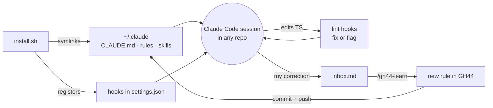
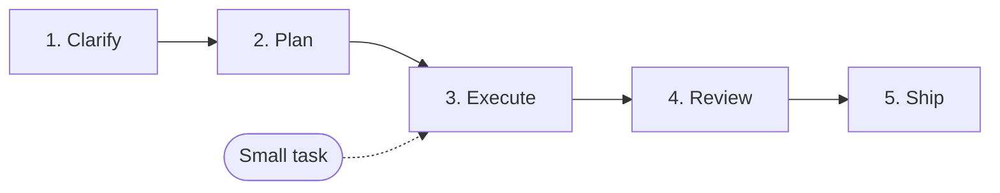

# GH44

**Gentrit's personal agent brain for Claude Code.**

Clone it once and every Claude Code session, in any repository, works the way I do: same rules, same workflow, same code conventions. It checks itself with lint hooks that cost no tokens, and it learns from my corrections as I go.

```bash
git clone git@github.com:gentrithalili1/gh44.git && gh44/install.sh
```

> The repository's own `CLAUDE.md` / `AGENTS.md` always wins on code conventions. GH44 fills the gaps.

---

## Contents

- [At a glance](#at-a-glance)
- [How it works](#how-it-works)
- [The workflow](#the-workflow)
- [Skills](#skills)
- [Agents](#agents)
- [Rules](#rules)
- [Lint checks](#lint-checks)
- [Hooks](#hooks)
- [Learning loop](#learning-loop)
- [Repository layout](#repository-layout)
- [Install](#install)
- [Uninstall](#uninstall)
- [Credits](#credits)

---

## At a glance

| Part | Lives in | What it does | Token cost |
| --- | --- | --- | --- |
| 🧭 **Rules** | `rules/` | How I work: communication, workflow, code, precedence, learning. Loaded in every session. | Always loaded, kept under 160 lines |
| 🧰 **Skills** | `skills/` | Step-by-step playbooks for clarifying, TDD, debugging, reviewing, shipping. Loaded only when the work needs them. | Only when used |
| 🤖 **Agents** | `agents/` | Subagents that review and verify in a fresh context, so the main session stays clean. | Only when used |
| 🔍 **Lint checks** | `lint/` | My conventions as ESLint rules, run on every TS edit. Fixes what it can, sends the rest back to Claude. | None |
| 🪝 **Hooks** | `hooks/` | Glue that runs lint, captures corrections, opens worktrees and guards the rules budget. | None |
| 🧠 **Learning** | `inbox.md`, `/gh44-learn` | Turns my corrections into new rules, committed back to this repo. | Only when learning |

---

## How it works



`install.sh` symlinks `CLAUDE.md`, `rules/` and every skill into `~/.claude`, so editing this repo changes every session at once. No copying, no re-installing after a `git pull`.

---

## The workflow

Five steps: **Clarify → Plan → Execute → Review → Ship**. Size the task first:

- **Small task** (a bug, a copy change, one clear area): go straight to **Execute** (`/gh44-implement <ticket>`), then **Ship**.
- **Big task** (a feature, open questions, several areas): every step, in order. A step ends before the next one starts.



| Step | You run | What happens | Done when |
| --- | --- | --- | --- |
| **1. Clarify** | `/gh44-clarify [ticket]` | Reads the Linear or Sentry ticket if you pass one, then interviews you in rounds of numbered questions, each with a recommended answer. Claude looks up facts itself and asks you only for decisions. | Nothing is left open and you confirm you are on the same page. |
| **2. Plan** | `/gh44-plan [ticket]` | Turns the clarified conversation, or a ticket on its own, into test seams and tracer-bullet slices, each with what it delivers, the units it touches, acceptance criteria and the slices that must land first. No code yet. | You approve the plan. |
| **3. Execute** | `/gh44-implement [ticket] [--worktree]` | Builds the approved plan slice by slice: a red → green test at the plan's seam (Matt's `tdd`), then typecheck and the slice's tests. Lint fixes quietly on every edit and reports at the end of the turn. Then `gh44-verifier` runs typecheck, lint and related tests, and `gh44-reviewer` reviews the change; clear fixes are applied, judgement calls come to you. Changes stay uncommitted. | The verifier passes and you get the report. |
| **4. Review** | Read implement's report | Implement already reviewed the change in my style (no PR needed: it reviews the local changes). Clear fixes are applied; you decide the numbered judgement calls ("apply 1 and 3"). Optional: `/code-review` for a bug hunt, `/simplify` for cleanups. | Every judgement call is decided. |
| **5. Ship** | `/gh44-create-pr` | Checks, commits, pushes and opens the PR with a summary visual, how to test and risk. | The PR is open. |

**Clarify is a proxy.** The interview is Matt Pocock's [`grilling`](https://github.com/mattpocock/skills) skill, installed unchanged (see [Upstream skills](#upstream-skills)). `/gh44-clarify` only adds reading the ticket first, and is named after the step it runs.

**Clarify and Plan run in the same session**, so the plan builds on everything the interview settled. Clarify decides _what_ to build; Plan decides _how_. A ticket that is already clear can go straight to `/gh44-plan <ticket>`: it asks up to 4 open questions itself, and sends you to `/gh44-clarify` when there are more. A plan with one slice means the task is small, so it skips to Execute.

```text
/gh44-clarify ABC-123   # optional: when the ticket is fuzzy
/gh44-plan              # seams + slices → you approve
/gh44-implement         # builds the plan, verifies, reviews itself
                        # you decide the judgement calls in its report
/gh44-create-pr         # commit, push, open the PR
```

**Implement follows your rules without being told.** `rules/` (code, structure, workflow) is loaded in every session, the plan already places each unit by the structure rules, and the lint hooks and verifier check the result. When the plan turns out wrong, implement stops and asks instead of changing it.

### Shortcuts

- **Worktree per ticket:** `/gh44-implement ABC-123 --worktree` builds in `.worktrees/ABC-123` on its own branch from the latest `main`; `--worktree <name>` picks the name (see [Worktrees and your editor](#worktrees-and-your-editor)).
- **Hand off a long session:** run `/gh44-handoff` and start a fresh session from the file it writes.
- **Merge conflicts:** run `/gh44-resolve-conflicts <pr>`.

---

## Skills

In workflow order. **Auto** skills load when the work matches, and you can also type them. **You type** skills run only when you call them.

| Step | Skill | How it starts | What it does |
| --- | --- | --- | --- |
| Clarify | `/gh44-clarify [ticket]` | You type | Proxy: reads the ticket if given, then runs Matt's `grilling` unchanged until nothing is open. |
| Plan | `/gh44-plan [ticket]` | You type | Test seams and tracer-bullet slices with blocking edges, from the conversation or a ticket. Ends when you approve. |
| Build | `/gh44-implement [ticket] [--worktree [name]]` | You type | Builds the approved plan, or a small ticket, slice by slice; verifies, reviews itself and reports. Never commits. |
| Build | `/gh44-debug` | Auto | Diagnosis loop for hard bugs, slowdowns and Sentry issues. |
| Review | `/gh44-code-review [pr]` | Auto | Reviews a PR, a branch or local changes (new files included) on two axes: **Standards** (the repo's documented rules, then my rules where the repo is silent, then my review habits, then code smells as suggestions) and **Spec** (the ticket's or plan's acceptance criteria: missing, wrong or scope creep). Every finding cites its source. Someone else's PR: posts only what you pick as a pending review. My own PR or local changes: applies the items I pick, then verifies. Implement runs the same review on its own changes. |
| Review | `/gh44-resolve-conflicts <pr>` | You type | Merges the base in a worktree, shows the resolutions, pushes after you approve. |
| Ship | `/gh44-create-pr` | Auto | Checks, commits, pushes and opens the PR with the repo's template. |
| Session | `/gh44-handoff [next focus]` | You type | Proxy: runs Matt's `handoff` unchanged, then prints the commands to continue in a fresh session. |
| Brain | `/gh44-learn` · `ingest` · `tidy` | Auto | Saves a correction as a rule, sorts the inbox, cleans up the rules. |
| Brain | `/gh44-writing-for-agents` | Auto | How to write skills, rules and `CLAUDE.md` files, this repo included. |

### Upstream skills

Skills I use exactly as their author wrote them are installed, not copied into `skills/`. [`upstream-skills.txt`](upstream-skills.txt) lists them. The ones I type get a thin `gh44-*` proxy, so every command I type stays `/gh44-*`; the ones Claude loads by itself are called by name. Update them with `npx skills update -g`.

| Skill | From | Called by |
| --- | --- | --- |
| `grilling` | [mattpocock/skills](https://github.com/mattpocock/skills) | `/gh44-clarify` |
| `handoff` | [mattpocock/skills](https://github.com/mattpocock/skills) | `/gh44-handoff` |
| `tdd` | [mattpocock/skills](https://github.com/mattpocock/skills) | `/gh44-implement` for every slice, and Claude by itself for test-first work |
| `codebase-design` | [mattpocock/skills](https://github.com/mattpocock/skills) | `tdd`, when the shape of an interface or seam is in question |

---

## Agents

Linked into `~/.claude/agents`. Each runs in its own context and returns only its result.

| Agent | Used by | Returns |
| --- | --- | --- |
| `gh44-reviewer` | `/gh44-code-review`, the end of `/gh44-implement` | The review in my style. Read-only; posting stays in the main session. |
| `gh44-verifier` | "Verify before done", `/gh44-create-pr` | `PASS`, or the typecheck, lint and related-test failures for the changed packages. |

---

## Rules

Always loaded, in every repository. Kept short on purpose: the session-start hook warns when they pass 160 lines.

| File | Covers |
| --- | --- |
| [`communication.md`](rules/communication.md) | Casual, short answers. One best option: just do it. Several real options: ask once, recommend one. |
| [`workflow.md`](rules/workflow.md) | Clarify → plan → execute → review → ship. Smallest correct change. Verify before saying done. Merge from `main`. |
| [`code.md`](rules/code.md) | Types, errors, async, naming, React and JSX, SEO and rendering, data layer, forms, tests. |
| [`structure.md`](rules/structure.md) | Where files live: unit shape, placement by importers, state flow, file kinds, homes, splitting hooks, refactors. |
| [`precedence.md`](rules/precedence.md) | The repo wins on code conventions; my rules win on how to work with me. |
| [`learning.md`](rules/learning.md) | When Claude may write a rule on its own, and when it must ask first. |

---

## Lint checks

My conventions as ESLint rules ([`lint/`](lint/)), run by hooks. Every TypeScript edit is fixed quietly, so the red → green loop runs uninterrupted; what cannot be fixed is reported at the end of the turn, and Claude fixes it before it stops. Inline `eslint-disable` comments are ignored.

**If the repository already configures an equivalent rule, mine turns off**, so the repo always wins.

| Area | Rules |
| --- | --- |
| Types | No `any`, no `as` assertions, no lint-disable comments |
| Naming | Booleans `is*`/`has*`/`should*`, handlers `handle*`, props interface `<Component>Props` |
| Functions & hooks | Params object for 2+ parameters, no hook destructuring, no `useEffect` |
| JSX | Function components only, no nested ternaries, no index `key`, no leaky `&&` renders |
| Structure | Sorted imports, `index` files only re-export, no generic folders, pure `utils/` |

---

## Hooks

Registered in `~/.claude/settings.json` by `install.sh`. All shell, no tokens.

| When | Hook | Does |
| --- | --- | --- |
| Session start | `budget-check.sh` | Warns when core rules pass 160 lines or the inbox fills up. |
| Every prompt | `capture-corrections.sh` | Catches short corrections (see [Learning loop](#learning-loop)). |
| Every prompt | `mark-turn.sh` | Marks the start of a turn for the end-of-turn check. |
| After a TS edit | `check-code.sh` | Runs ESLint on the file and fixes what it can. Reports nothing. |
| End of turn | `check-changed.sh` | Reports what is left on the lines changed in every TS file touched this turn, however it was edited, and sends it back to Claude. |
| New worktree | `prepare-worktree.sh` | Puts a detached worktree on a branch named after its folder, from the remote's default branch. Copies the main checkout's gitignored `.env*` files and installs from the lockfile. A repo's git-excluded `.worktree-setup.sh` replaces these steps. Run by `/gh44-implement --worktree` and by your editor's worktree hook. |

### Worktrees and your editor

`/gh44-implement --worktree` works in any setup:

- **Agent in a terminal:** run it from the main checkout. It creates `.worktrees/<name>` (the ticket ID unless you pass a name), or reuses it when it exists, prepares it and moves the session there.
- **Agent inside an editor window:** a running session cannot move to another window, so create the worktree in the editor first, named after the ticket ID, then run `/gh44-implement <ticket> --worktree` in that worktree's window. It prepares the worktree and creates the branch if the editor's hook did not.

If the editor can run a command after it creates a worktree, point it at `<gh44>/hooks/prepare-worktree.sh <worktree> <main checkout>`, and set its worktree folder to `.worktrees`, so the worktree is ready before the agent starts.

---

## Learning loop

GH44 gets better every time I correct it.

1. **Capture.** A prompt of up to 100 characters starting with *don't, never, always, stop, prefer, I prefer* or *not like this* (optionally after `no,`) is flagged and saved to `inbox.md`.
2. **Learn.** Claude finishes the task, then writes the rule to the right file here, commits and pushes, and tells me in one line. If it's unsure, it shows me the rule first and waits.
3. **Ingest.** `/gh44-learn ingest` sorts anything still left in the inbox, including notes and links I paste there myself.
4. **Tidy.** `/gh44-learn tidy` merges duplicates, resolves contradictions, drops stale rules and moves topic-specific ones into skills when the core passes 160 lines.

---

## Repository layout

```text
gh44/
├── CLAUDE.md        # entry point, linked to ~/.claude/CLAUDE.md
├── rules/           # always-on rules
├── skills/          # gh44-* skills, each linked into ~/.claude/skills
├── agents/          # gh44-* subagents, each linked into ~/.claude/agents
├── hooks/           # shell hooks registered by install.sh
├── lint/            # ESLint config and custom rules
├── tests/           # shell tests for hooks, lint and install
├── docs/            # design spec and plan
├── install.sh       # idempotent installer
├── uninstall.sh     # removes links, hooks, upstream skills and optionally the repo
├── upstream-skills.txt  # skills installed as they are, called by gh44 proxies
├── log.md           # append-only log of every rule learned
└── inbox.md         # captured corrections (gitignored)
```

---

## Install

**Needs:** Homebrew, Node and pnpm.

```bash
git clone git@github.com:gentrithalili1/gh44.git && gh44/install.sh
```

Then open a new Claude Code session.

The installer is safe to run again. It:

1. Installs `jq` with Homebrew if it's missing.
2. Installs the lint packages with pnpm.
3. Symlinks `CLAUDE.md`, `rules/` and every skill into `~/.claude`. It stops before changing anything if a real file is in the way.
4. Installs the skills in `upstream-skills.txt` with the [`skills`](https://github.com/vercel-labs/skills) CLI, as copies in `~/.claude/skills`. A skill already there is left alone.
5. Registers the 7 hooks, backing up `settings.json` first.

---

## Uninstall

```bash
gh44/uninstall.sh                # remove links, hooks and upstream skills, keep the repo
gh44/uninstall.sh --remove-repo  # also delete the repo
```

It only removes links that point into this repo, hooks that run its scripts and upstream skills the skills lock file records as installed from their listed repository, and it backs up `settings.json` first. Your other skills, hooks and settings stay.

`--remove-repo` refuses, before changing anything, when something would be lost: uncommitted changes, unpushed commits, or items still in `inbox.md`.

---

## Credits

Some skills are adapted from [Matt Pocock's skills](https://github.com/mattpocock/skills) (MIT). See [`NOTICE`](NOTICE).
